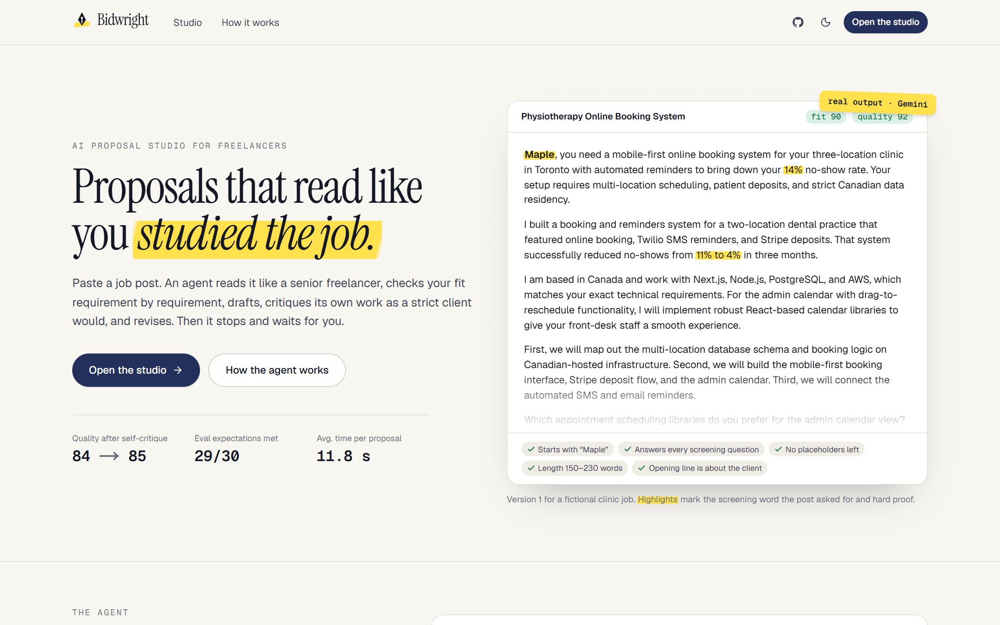
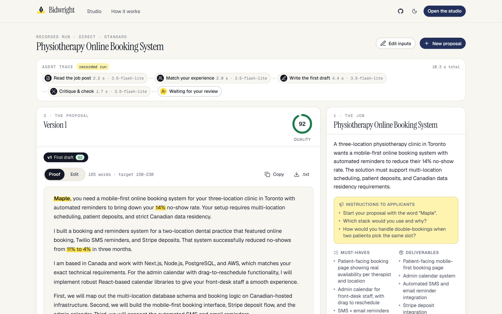
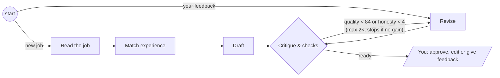
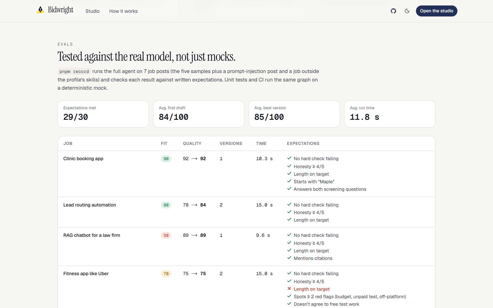

# Bidwright: AI proposal studio

**Proposals that read like you studied the job.** Paste a freelance job post. A LangGraph agent reads it like a senior freelancer, scores your fit requirement by requirement, drafts a proposal, critiques it as a demanding client would, revises until it clears the bar, and then stops and waits for your approval.

**Live demo:** _add your Vercel URL here_



## What it does

- **Reads the job:** must-haves, deliverables, budget, client red flags, and every instruction to applicants, including the hidden screening words clients use to filter bulk applications ("start your proposal with the word _Maple_").
- **Scores your fit honestly:** each requirement is matched to the exact line of your profile that proves it (strong / partial / missing). The score is computed in code from that matrix, and gaps get an honest framing instead of invented experience.
- **Drafts, critiques, revises:** a six-part rubric (hook, specificity, proof, plan, close, honesty) plus eight deterministic checks. Below the quality bar, or when it overclaims, the draft goes back for revision automatically.
- **Leaves the final say to you:** approve and copy, edit by hand (the checks re-run as you type), or tell the agent what to change. Version history, word-level diffs and "what changed" notes show every step.
- **Works without a key:** recorded real runs replay in the studio, so the demo never breaks on a rate limit.



## How the agent works



| Step | Model | Output (validated with zod) |
| --- | --- | --- |
| Read the job | fast | `JobBrief`: title, summary, must-haves, deliverables, budget, client signals, instructions, screening questions |
| Match experience | fast | `Fit`: requirement matrix with evidence, proof points, gaps with honest framing, winning angle |
| Draft / Revise | writer, falls back to fast | `Draft`: proposal, screening answers, milestones (+ change notes on revisions) |
| Critique | fast + code | `Critique`: 1–5 per rubric criterion, quoted edits, verdict; plus 8 deterministic checks |

**Design decisions**

- **Structured output everywhere.** Each zod schema is sent to Gemini as `responseJsonSchema` and parsed again on the way back. Busy or malformed replies retry, then fall back to the second model.
- **Scores in code, judgments in the model.** Fit = weighted requirement matrix. Quality = 80% rubric + 20% checks, capped at 59 when a required check fails or honesty is below 3.
- **Stateless human-in-the-loop.** The run ends at "waiting for your review" and the browser keeps the state. Feedback is posted back with that state and re-enters the graph at `revise`. No checkpointer, session store or database is needed, which suits a serverless deployment.
- **Streaming.** The route handler streams NDJSON: a line when each node starts and another with its state update when it finishes, so the trace and cards fill in live.
- **Untrusted input.** Job posts and profiles are wrapped in tagged blocks. Prompts tell the model to treat them as data, and text aimed at AI tools is recorded as a red flag. The eval suite includes a prompt-injection post.

## Evals

`pnpm record` runs the full agent on 7 job posts against the real model: the 5 samples, a prompt-injection post, and a job outside the profile's skills. It saves the sample runs for replay and checks each result against written expectations: no failing required check, honesty ≥ 4, length on target, plus case-specific ones (starts with the screening word, spots the unpaid test task, ignores the injected instruction, scores the off-skill job as a long shot). Results are committed in [`src/data/eval-report.json`](src/data/eval-report.json) and shown on `/how-it-works`.



Unit tests (Vitest) run the same LangGraph graph on a deterministic mock model: routing, the revise loop, the feedback re-entry, the checks, scoring, diffing and annotation. CI also builds the app and smoke-tests the streaming API on the mock.

## Tech stack

Next.js 16 (App Router, route handlers, Cache Components) · React 19 · TypeScript · LangGraph.js · Google Gemini via `@google/genai` · zod 4 · Tailwind CSS 4 · Vitest · GitHub Actions · Vercel

## Run it locally

```bash
pnpm install
cp .env.example .env.local   # add GEMINI_API_KEY (free key from Google AI Studio)
pnpm dev                     # http://localhost:3000
```

No key? Set `BIDWRIGHT_MOCK=1` in `.env.local` to run the whole graph on the mock model, or leave both unset and the studio replays recorded runs.

| Script | What it does |
| --- | --- |
| `pnpm check` | lint + type-check + unit tests |
| `pnpm try clinic-booking --feedback "Mention PHIPA"` | one run in the terminal, optionally with a feedback round |
| `pnpm record [caseId]` | real-model eval suite; refreshes the recordings and the report |
| `pnpm smoke http://localhost:3000` | calls the running API the way the studio does |

## Deploy (Vercel, free tier)

Import the repo in Vercel and set `GEMINI_API_KEY`, `NEXT_PUBLIC_SITE_URL` and optionally `GEMINI_MODEL` / `GEMINI_WRITER_MODEL`. The agent route allows up to 120 s; a typical run takes 10–30 s. An in-memory rate limit (8 runs per 10 minutes per IP) protects the free Gemini quota.

## Project structure

```
src/lib/agent/   graph.ts (LangGraph), prompts.ts, schemas.ts (zod), llm.ts (Gemini + mock),
                 checks.ts (deterministic checks), score.ts, state.ts, run.ts (streaming)
src/app/         / (landing), /studio, /how-it-works, /api/agent (NDJSON stream)
src/components/  studio/ (trace, brief, fit, proposal, critique), home/, site/
scripts/         record.ts (evals), try.ts, smoke.ts
```

Sample job posts and the demo profile are fictional.

## License

MIT
